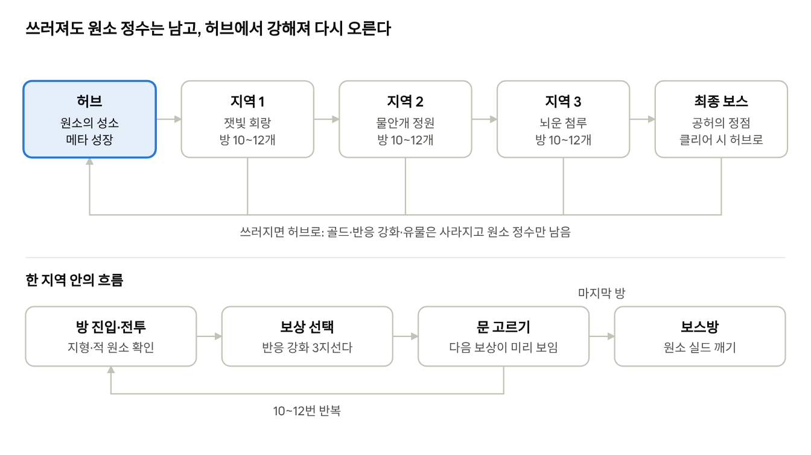

# 원소 반응 액션 로그라이트 기획서

Nov 4, 2026 · @HanGyeol Jang

## 개요

**가제: 「원소 저글러」** — 원소 4개를 실시간으로 바꿔 끼우며 반응을
꽂는 탑다운 픽셀아트 액션 로그라이트.

| 항목       | 내용                                    |
|------------|-----------------------------------------|
| 장르       | 액션 로그라이트 (하데스식 방 단위 진행) |
| 시점       | 탑다운                                  |
| 아트       | 픽셀아트                                |
| 플랫폼     | 웹 브라우저 (PC, 키보드 + 마우스)       |
| 한 판 길이 | 20~30분                                 |
| 개발 규모  | 1인 취미 개발, 바이브코딩               |

### 핵심 재미: 컨트롤

이 게임의 재미는 **원소를 손으로 저글링해서 반응을 정확하게 꽂는
손맛**이에요. 숫자로 강해지는 재미는 최소화합니다.

- 원소 4개(불·물·바람·번개)를 처음부터 전부 사용

- 전투는 원소 반응 하나로만 굴러감. 일반 공격은 약하고, 반응을 못
  터뜨리면 못 이김

- 런마다 달라지는 건 반응 강화와 유물

- 영구 성장은 2차 반응 해금과 캐릭터 스탯 두 가지뿐

## 세계관 (가안)

스토리는 아직 확정 전이라 로그라이트 구조에 맞는 최소 설정만 잡아둬요.

원소의 균형이 무너진 대륙 아르케아. 원소를 삼키는 공허의 첨탑이
솟아올랐고, 주인공은 네 원소를 모두 다룰 수 있는 유일한 존재로 첨탑을
오릅니다. 쓰러지면 원소의 성소(허브)에서 다시 깨어나요.

- "죽으면 허브에서 부활"이 설정으로 설명됨

- 지역은 첨탑을 오르는 구간으로 구성

## 런 구조

런 구조 · 지역 3개 + 최종 보스, 사망 시 허브

한 판은 지역 3개와 최종 보스로, 20~30분이에요. 방을 클리어할 때마다
보상을 고르고, 문에 표시된 다음 보상을 보고 경로를 정해요. 문 보상은
반응 강화, 유물(엘리트방), 상점, 회복 중 하나예요.

## 조작과 원소 전환

캐릭터 한 명이 원소 4개를 실시간으로 바꿔 끼워요. 지금 어떤 원소
상태냐에 따라 같은 버튼이라도 나가는 공격이 달라집니다.

### 조작

| 입력          | 행동                          |
|---------------|-------------------------------|
| WASD          | 이동                          |
| 마우스        | 조준                          |
| 좌클릭        | 기본 공격 (현재 원소)         |
| 우클릭        | 원소 스킬 (현재 원소, 쿨다운) |
| 1 / 2 / 3 / 4 | 불 / 물 / 바람 / 번개로 전환  |
| 스페이스      | 구르기 (무적 0.3초, 2회 충전) |
| E             | 상호작용 (보상 선택, 문)      |

### 원소별 공격 세트 (고정)

원소마다 기본 공격과 스킬이 정해져 있고, 런마다 바뀌지 않아요. 매 판
같은 손으로 싸우니까 컨트롤 숙련이 그대로 쌓입니다.

| 원소 | 기본 공격                      | 스킬             | 성격              |
|------|--------------------------------|------------------|-------------------|
| 불   | 빠른 화염 3연타 (근접)         | 화염 돌진        | 공격적, 근접 딜   |
| 물   | 물줄기 (원거리)                | 물웅덩이 장판    | 견제, 지형 만들기 |
| 바람 | 넓은 부채꼴 베기               | 회오리 투척      | 범위, 밀어내기    |
| 번개 | 느리지만 강한 낙뢰 (지정 위치) | 순간이동 후 방전 | 한 방, 위치 이동  |

- 일반 공격 피해는 낮게 설정. 딜의 대부분은 반응에서 나옴

- 모든 공격은 맞은 대상에게 자기 원소를 부착

### 전환 규칙

- 전환 쿨다운 0.5초 (원소별이 아니라 전체 공용)

- **전환 직후 첫 공격 강화**: 피해 +50%, 부착 시간 2배

- 스킬 쿨다운은 원소별로 따로 돌아감 → 불 스킬 쓰고 바로 물로 바꿔 물
  스킬, 이런 연속 사용이 가능

빠르게 바꿔가며 반응을 꽂는 게 기본 컨트롤이고, "어떤 순서로 바꿀지"가
매 순간의 판단이 돼요.

## 원소 반응

전투의 전부예요. 시작할 때 1차 반응 6종 + 중첩 반응 4종 + 지형 반응을 쓸
수 있고, 2차 반응 10종은 메타 성장으로 해금됩니다.

### 부착 규칙

- 원소 공격에 맞으면 그 원소가 **3초간 부착** (전환 직후 첫 공격은 6초)

- 부착된 상태에서 다른 원소에 맞으면 1차 반응 → 부착 해제, 반응별 **잔여
  상태**가 2초간 남음

- 같은 원소를 3초 안에 3번 맞으면 중첩 반응

- 잔여 상태에 원소를 맞추면 2차 반응 (해금 후)

### 1차 반응 6종 (시작부터)

역할이 겹치지 않게 딜 / 광역 / 정지 / 장판 / 넉백 / 몰이로 나눴어요.

| 조합        | 반응     | 효과                         | 역할                 | 잔여 상태 |
|-------------|----------|------------------------------|----------------------|-----------|
| 불 + 물     | 증발     | 단일 대상 큰 피해            | 보스 딜              | 습기      |
| 물 + 번개   | 감전     | 주변 적에게 연쇄 피해        | 잡몹 정리            | 대전      |
| 물 + 바람   | 빙결     | 적 2초 정지 (보스 0.5초)     | 패턴 끊기, 위기 탈출 | 얼음      |
| 불 + 바람   | 화염폭풍 | 불길 장판이 퍼짐             | 지역 장악            | 불길      |
| 번개 + 불   | 과부하   | 폭발 + 넉백                  | 밀어내기             | 과열      |
| 바람 + 번개 | 뇌풍     | 주변 적을 한 점으로 빨아들임 | 몰이                 | 소용돌이  |

### 중첩 반응 4종 (시작부터)

원소를 바꿀 틈이 없을 때 쓰는 보조 수단이에요. 1차 반응보다 약하게.

| 원소    | 반응   | 효과                  |
|---------|--------|-----------------------|
| 불 ×3   | 작열   | 대상 몸에서 작은 폭발 |
| 물 ×3   | 침수   | 이동속도 크게 감소    |
| 바람 ×3 | 돌풍   | 멀리 날려버림         |
| 번개 ×3 | 과전류 | 짧은 기절             |

### 지형 반응 (시작부터)

방 안의 지형도 원소를 가지고 있어서, 적을 지형으로 몰아넣는 플레이가
가능해요.

| 지형      | \+ 원소 | 결과                  |
|-----------|---------|-----------------------|
| 물웅덩이  | 번개    | 웅덩이 전체가 전기장  |
| 물웅덩이  | 바람    | 얼음 바닥 (미끄러짐)  |
| 마른 풀   | 불      | 들불로 번짐           |
| 바람 통로 | 불      | 화염 통로             |
| 바람 통로 | 번개    | 전류가 통로 따라 이동 |

물 스킬(물웅덩이 장판)로 지형을 직접 만들 수도 있어요.

### 2차 반응 10종 (메타 해금)

1차 반응이 남긴 잔여 상태(2초)에 원소를 맞추면 터져요. 1차 → 2차로
이어지는 흐름이라 외우기 쉽고 연계 콤보 손맛이 큽니다.

| 잔여 상태       | \+ 원소 | 2차 반응    | 효과                         |
|-----------------|---------|-------------|------------------------------|
| 얼음 (빙결)     | 불      | 해빙 폭발   | 빙결 해제 대신 큰 피해       |
| 얼음 (빙결)     | 번개    | 파쇄        | 얼음 파편이 사방으로 발사    |
| 대전 (감전)     | 바람    | 방전 확산   | 전류가 멀리 퍼짐             |
| 대전 (감전)     | 물      | 전해        | 감전 연쇄 횟수 2배           |
| 불길 (화염폭풍) | 물      | 증기 장막   | 적 시야 차단, 아군 회피 증가 |
| 불길 (화염폭풍) | 번개    | 플라스마    | 장판 피해 폭증               |
| 습기 (증발)     | 번개    | 뇌우        | 작은 낙뢰 여러 발            |
| 습기 (증발)     | 바람    | 서리 바람   | 광역 둔화                    |
| 과열 (과부하)   | 불      | 연쇄 폭발   | 주변으로 폭발이 이어짐       |
| 소용돌이 (뇌풍) | 불      | 화염 회오리 | 몰린 적 전체에 지속 피해     |

### 반응 피드백

실시간에서 반응을 바로 알아보게, 반응마다 **보자마자 아는 연출**을
붙여요: 반응 이름 텍스트, 원소색 이펙트, 고유 효과음, 2차 반응은 화면
흔들림 + 히트스탑 추가.

## 컨트롤 장치

반응을 "내가 거는 것"만이 아니라 "내가 당하는 것"으로도 만들어서, 회피와
위치 선정에 이유를 줘요.

### 적도 원소를 가진다

- 적의 공격에 맞으면 **플레이어에게도 원소가 부착**됨

- 물 적에게 맞은 상태로 번개 적에게 맞으면 내가 감전당함 → 맞으면 안
  되는 이유가 하나 더 생김

- 플레이어 머리 위에도 부착 원소 아이콘 표시

### 완벽 회피 = 원소 흡수

- 적 공격이 닿기 직전(0.15초 안)에 구르면 **완벽 회피**

- 완벽 회피하면 그 공격의 원소를 빼앗아서, 다음 공격 1회에 추가 원소로
  실음

- 예: 불 상태로 물 공격을 완벽 회피 → 다음 불 공격이 물까지 실려서 혼자
  증발

- 잘 피하는 사람이 반응을 더 자주 낼 수 있음

### 지형 활용

- 방마다 물웅덩이·마른 풀·바람 통로 같은 원소 지형 배치

- 적을 지형 위로 몰아넣는 게 하나의 전략 (뇌풍으로 몰고 → 웅덩이에서
  번개)

- 지형은 내게도 똑같이 적용됨 (내가 웅덩이에 서 있으면 감전당할 수 있음)

### 보스 원소 실드

- 보스는 특정 반응으로만 깨지는 실드를 두름

- 실드가 있는 동안은 피해가 거의 안 들어감

- 페이즈마다 요구 반응이 바뀜 → 공격 순서를 계속 바꿔야 함

### 타격감

컨트롤 게임이라 손맛이 곧 재미예요. 1단계 프로토타입부터 넣습니다.

- 히트스탑: 맞는 순간 0.05초 멈춤 (반응은 0.1초)

- 넉백, 화면 흔들림, 피격 시 흰색 깜빡임

- 구르기 잔상, 피해 숫자 튀어오르기

## 적과 보스

적은 "행동 유형 × 원소" 조합으로 찍어내서 적은 작업량으로 종류를 늘려요.
보스는 지역당 1체 + 최종 보스.

### 일반 적: 행동 유형 × 원소

| 유형     | 행동                      | 플레이어에게 요구하는 것 |
|----------|---------------------------|--------------------------|
| 돌격형   | 거리 좁히고 근접 공격     | 거리 유지, 구르기        |
| 사수형   | 거리 두고 투사체          | 접근 or 원거리 반응      |
| 자폭형   | 다가와 폭발 (자기 원소로) | 우선 처치, 폭발 회피     |
| 방패형   | 정면 피해 무효            | 뒤로 돌기, 장판·낙뢰     |
| 소환사형 | 졸개 소환                 | 우선 처치                |

유형 5개 × 원소 4개 = 적 20종. 같은 돌격형이라도 물 돌격형에게 맞으면
물이 부착되니까, 어떤 원소 적이 섞여 있느냐에 따라 방마다 판단이
달라져요.

**엘리트**는 일반 적에 수식어가 붙어요: 신속, 거대화, 원소 2개 보유,
분열(죽으면 작은 개체 2마리), 실드(특정 반응으로만 깨짐).

### 보스

| 지역              | 보스        | 실드 해제 반응              | 핵심 패턴                                      |
|-------------------|-------------|-----------------------------|------------------------------------------------|
| 1\. 잿빛 회랑     | 잿불 골렘   | 1페이즈 증발 → 2페이즈 빙결 | 내려찍기 충격파, 용암 장판. 반응 기본기 시험   |
| 2\. 물안개 정원   | 호수의 마녀 | 감전 → 화염폭풍             | 분신 3체, 진짜만 원소 부착됨. 웅덩이 지형 다수 |
| 3\. 뇌운 첨루     | 폭풍 그리폰 | 과부하 → 뇌풍               | 급강하, 바람 통로로 플레이어를 끌어당김        |
| 최종. 공허의 정점 | 공허의 핵   | 페이즈마다 무작위           | 플레이어의 원소를 일시적으로 봉인하는 패턴     |

- 큰 공격은 바닥에 경고 영역을 0.8~1.2초 먼저 표시 → 구르기·완벽 회피로
  대응

- 페이즈 전환: HP 60%, 25%

## 런 보상: 반응 강화와 유물

원소와 공격 세트가 고정이니까, 매 판을 다르게 만드는 건 이 두 가지예요.
둘 다 런이 끝나면 사라집니다.

### 반응 강화 (방 클리어 보상, 3지선다)

특정 반응의 성능을 바꾸는 보상이에요. 고르다 보면 "이번 판은 감전
빌드"처럼 주력 반응이 자연스럽게 정해집니다.

| 반응     | 강화 예시                                               |
|----------|---------------------------------------------------------|
| 증발     | 증발 피해 +40% / 증발 시 구르기 1회 즉시 충전           |
| 감전     | 연쇄 대상 +2 / 감전으로 처치 시 주변 적에게 물 부착     |
| 빙결     | 빙결 시간 +1초 / 빙결된 적 처치 시 주변도 빙결          |
| 화염폭풍 | 장판 크기 +50% / 장판 위에서 내 이동속도 증가           |
| 과부하   | 폭발 범위 2배 / 넉백된 적이 벽에 부딪히면 추가 피해     |
| 뇌풍     | 빨아들이는 힘 2배 / 뇌풍 후 3초간 번개 스킬 쿨다운 없음 |
| 중첩     | 중첩 필요 횟수 3 → 2                                    |
| 공통     | 모든 반응 피해 +15% / 반응 시 HP 소량 회복              |

- 같은 반응 강화는 최대 3단계까지 겹침

- 3단계를 찍으면 그 반응의 **극의**(특수 효과)가 열림. 예: 빙결 극의 =
  빙결된 적이 얼음 조각상이 되어 장애물로 남음

### 유물 (엘리트·상점·보스 보상, 최대 5개)

스탯이 아니라 플레이 방식을 바꾸는 효과예요.

| 유물          | 효과                                              |
|---------------|---------------------------------------------------|
| 바람의 깃     | 완벽 회피 판정 1.5배                              |
| 섬광의 장화   | 원소 전환 후 2초간 이동속도 +30%                  |
| 얼어붙은 심장 | 빙결 시간 2배, 대신 빙결 상태 적에게 주는 피해 0  |
| 끓는 피       | HP가 절반 이하일 때 모든 반응 피해 +40%           |
| 두 갈래 손    | 전환 직후 첫 공격 강화가 2회로                    |
| 피뢰침        | 나에게 번개가 부착되면 주변 적 전부에게 번개 부착 |
| 고요한 물     | 물 스킬 웅덩이가 2개까지 유지                     |
| 공허의 파편   | 중첩 반응이 1차 반응 판정으로 바뀜                |

### 런 화폐

- 골드: 방 클리어·적 처치로 획득, 상점에서 유물·회복 구매. 런 끝나면
  사라짐

- 원소 정수: 보스·엘리트가 드롭, 죽어도 유지 → 메타 성장에 사용

## 메타 성장

죽어도 남는 성장은 두 가지뿐이에요. 허브(원소의 성소)에서 원소 정수를
써서 올립니다.

### 2차 반응 해금

- 처음엔 1차·중첩·지형 반응만 사용 → 손에 익을 즈음 2차 반응이 열리면서
  같은 게임이 한 단계 깊어짐

- 2차 반응 10종을 하나씩 정수로 해금

- 해금 조건에 "해당 1차 반응 누적 50회" 같은 숙련 조건을 같이 걸어서,
  많이 써본 반응부터 깊어지게

- 추천 해금 순서: 해빙 폭발 → 전해 → 증기 장막 → 나머지 (초반엔 효과가
  직관적인 것부터)

### 캐릭터 스탯

| 스탯        | 단계  | 최대치         |
|-------------|-------|----------------|
| 최대 HP     | 5단계 | +50%           |
| 공격력      | 5단계 | +25%           |
| 이동속도    | 3단계 | +10%           |
| 구르기 충전 | 1단계 | 2회 → 3회      |
| 회복 포션   | 2단계 | 런당 1개 → 3개 |
| 부착 시간   | 3단계 | 3초 → 3.6초    |

- 컨트롤이 중심이라 **스탯을 전부 올려도 체감 30~40% 정도**로 상한을 둠

- 공격력보다 생존·편의 쪽 수치를 넉넉하게 줘서, 초보는 버티기 쉬워지고
  고수는 실력 차이가 그대로 드러나게

## 아트와 애니메이션

핵심 전략은 세 가지예요: **규격을 먼저 고정**하고, **원소 차이는
색으로만** 내고, **움직임의 절반은 코드로** 만든다. 이렇게 하면 직접
그려야 하는 프레임이 캐릭터 기준 50장 정도로 줄어요.

### 기본 규격

| 항목             | 값                                 | 이유                                             |
|------------------|------------------------------------|--------------------------------------------------|
| 게임 내부 해상도 | 480 × 270                          | 정수배(×4)로 1920 × 1080에 딱 맞음               |
| 캐릭터·적 크기   | 32 × 32 px                         | 탑다운에서 표정·무기 구분 가능한 최소 크기       |
| 타일 크기        | 16 × 16 px                         | 방 하나 = 30 × 17 타일                           |
| 이펙트·투사체    | 8 ~ 16 px                          | 코드 생성으로 대량 제작                          |
| 팔레트           | 24색 고정 (원소색 4계열 포함)      | 색이 통일되면 실력 없어도 픽셀아트가 정돈돼 보임 |
| 방향             | 4방향 (아래·위·옆, 옆은 좌우 반전) | 탑다운 픽셀아트 표준, 작업량 1/2                 |

Phaser 설정에서 pixelArt: true, roundPixels: true를 켜야 확대할 때
픽셀이 뭉개지지 않아요.

### 원소 차이는 색 레이어로

원소 4개 × 모션 전부를 따로 그리면 작업량이 4배예요. 대신 스프라이트를
두 장으로 나눕니다.

- **본체 레이어**: 몸, 얼굴, 옷 — 원소와 무관하게 하나만 그림

- **원소 레이어**: 망토·장갑·눈빛처럼 원소색이 들어갈 부분만 흰색으로
  그림 → 코드에서 setTint(원소색)

- 원소 전환하면 원소 레이어 색만 바뀜. 적도 똑같이 해서 "행동 유형
  5종"만 그리면 원소별 적 20종이 나옴

### 캐릭터 애니메이션 목록

| 애니메이션          | 프레임 | 방향 | 합계     |
|---------------------|--------|------|----------|
| 대기                | 2      | 3    | 6        |
| 달리기              | 4      | 3    | 12       |
| 구르기              | 4      | 3    | 12       |
| 근접 공격 (불·바람) | 3      | 3    | 9        |
| 시전 (물·번개)      | 3      | 3    | 9        |
| 피격                | 1      | 3    | 3        |
| 사망                | 4      | 1    | 4        |
| **합계**            |        |      | **55장** |

원소별 공격 차이는 캐릭터 모션이 아니라 이펙트(불꽃, 물줄기, 바람 궤적,
번개)로 표현해요. 캐릭터는 "휘두르기"와 "시전" 두 동작만 있으면 됩니다.

### 코드로 만드는 움직임 (절차적 애니메이션)

프레임을 더 그리는 대신 코드로 움직임을 얹어요. 바이브코딩으로 제일 빨리
효과 보는 부분입니다.

| 효과            | 구현                                       | 효과                        |
|-----------------|--------------------------------------------|-----------------------------|
| 숨쉬기          | 대기 중 scaleY 1.0 ↔ 1.04 반복 트윈        | 2프레임 대기도 살아 보임    |
| 걷기 바운스     | 달리는 동안 y를 1~2px 위아래로             | 4프레임 달리기가 부드러워짐 |
| 스쿼시·스트레치 | 구르기 시작 시 납작, 끝날 때 길쭉          | 탄성 있는 손맛              |
| 공격 전진       | 공격 순간 조준 방향으로 4px 밀기           | 타격에 무게감               |
| 피격 플래시     | setTintFill(0xffffff) 0.05초               | 맞은 걸 즉시 인지           |
| 구르기 잔상     | 0.04초마다 반투명 복제본 → 페이드          | 속도감                      |
| 사망 분해       | 스프라이트를 픽셀 파티클로 흩뿌림          | 사망 프레임 없이도 연출     |
| 원소 전환       | 원소색 링이 퍼지는 파티클 + 레이어 색 변경 | 전환을 눈으로 확인          |

### 에셋 제작 방법

| 대상                      | 추천 방법                                                                         |
|---------------------------|-----------------------------------------------------------------------------------|
| 프로토타입 전부           | 도형(사각형·원)으로 시작. 아트 없이 손맛부터 확인                                 |
| 투사체·이펙트·아이콘·타일 | 코드 생성 (아래 예시)                                                             |
| 캐릭터·적 프레임          | 처음엔 코드 생성으로 임시본 → 나중에 Aseprite(유료) 또는 Piskel(무료 웹)로 다듬기 |
| 반응 이펙트               | Phaser 파티클 + 원소색                                                            |
| 허브 배경·초상화          | AI 이미지 생성 후 픽셀화 (축소 + 팔레트 색으로 양자화)                            |

AI 이미지 생성은 한 장짜리 그림엔 쓸 만하지만, 애니메이션 프레임끼리
모양이 일정하지 않아서 캐릭터 프레임용으로는 비추천이에요.

### 코드 생성 예시

Phaser는 문자열 그리드로 텍스처를 바로 만드는 기능이 있어요. 문자 하나가
팔레트 색 하나, .은 투명입니다.

const FIRE_BOLT = \[  
'..22..',  
'.2332.',  
'233332',  
'.2332.',  
'..22..',  
\];  
this.textures.generate('fireBolt', {  
data: FIRE_BOLT,  
pixelWidth: 1,  
palette: PALETTE, // 우리 팔레트 24색  
});

AI에게 스프라이트를 요청할 때 쓰는 프롬프트 틀:

32x32 픽셀아트 탑다운 캐릭터, 아래 방향 대기 자세.  
문자열 배열 32줄, 각 줄 32자로 출력.  
팔레트: . 투명, 0 외곽선(어두운 남색), 1~3 피부 3단계, 4~6 옷 3단계, 7
원소 레이어(흰색)  
규칙: 외곽선 1px, 빛은 왼쪽 위에서, 색마다 밝음/중간/어둠 3단계만 사용.

### 스프라이트시트 규칙

- 프레임 크기, 파일명, 애니메이션 이름을 처음에 정해서 anims.json에 기록

- 임시 코드 생성 아트 → 손그림으로 바꿀 때 같은 규격으로 덮어쓰기만 하면
  코드 수정 없음

- Aseprite로 그릴 경우 JSON과 함께 내보내면 Phaser가 태그별 애니메이션을
  바로 읽음 (load.aseprite)

## 기술 구조

Phaser 3 + TypeScript + Vite로 만들어요. 반응·강화·유물을 전부 데이터
파일로 빼서, 밸런스 조정이나 콘텐츠 추가를 코드 수정 없이 할 수 있게
하는 게 핵심이에요.

### 스택

| 항목    | 선택         | 이유                                                  |
|---------|--------------|-------------------------------------------------------|
| 엔진    | Phaser 3     | 2D 웹 게임 표준, 물리·카메라·입력·파티클 내장         |
| 언어    | TypeScript   | 원소 상태·반응 데이터가 복잡해서 타입이 큰 도움       |
| 빌드    | Vite         | 빠른 개발 서버                                        |
| 방 제작 | Tiled        | 방 템플릿을 타일로 그리고 지형 원소를 오브젝트로 배치 |
| 저장    | localStorage | 메타 성장만 저장 (런 중 저장은 없음)                  |

### 핵심 설계: 원소 상태 엔진

플레이어·적·지형이 전부 같은 "원소 상태" 컴포넌트를 가져요. 반응 판정을
한 곳에서 처리하니까 "적이 나한테 반응 걸기" 같은 것도 추가 코드 없이
됩니다.

1.  모든 공격은 원소 1개를 실어서 대상의 원소 상태에 전달

2.  원소 상태는 부착 원소, 남은 시간, 중첩 횟수, 잔여 상태를 기록

3.  새 원소가 들어오면 반응 표(reactions.json)에서 조합을 찾아 반응 발동

4.  반응 효과에 런 중 강화·유물 수정치를 적용

{  
"id": "electro_charged",  
"name": "감전",  
"tier": 1,  
"inputs": \["water", "lightning"\],  
"effect": { "type": "chain", "damage": 1.8, "targets": 3, "range": 64
},  
"leaves": "charged",  
"leaveDuration": 2.0,  
"vfx": "spark_burst",  
"sfx": "zap"  
}

{  
"id": "boon_chain_plus",  
"reaction": "electro_charged",  
"name": "연쇄 대상 +2",  
"maxStack": 3,  
"modify": { "targets": "+2" }  
}

### 런 생성

- 지역마다 방 템플릿 15~20개를 Tiled로 제작

- 런 시작 시 템플릿을 무작위로 골라 10~12개 연결, 마지막은 보스방 고정

- 문 위에 다음 방 보상 아이콘 표시 (반응 강화 / 유물 / 상점 / 회복) →
  경로 선택

### 폴더 구조

src/  
data/ reactions.json, boons.json, relics.json, enemies.json, meta.json,
anims.json  
element/ elementState.ts, reactionEngine.ts  
combat/ attacks.ts, damage.ts, hitstop.ts  
entities/ player.ts, enemy.ts, bosses/  
run/ runGenerator.ts, rewards.ts  
art/ palette.ts, generatedSprites.ts, proceduralAnim.ts  
scenes/ Hub, Room, Boss, Reward, UI  
main.ts

### 성능

- 히트박스는 원·사각형만 (Arcade Physics)

- 투사체·이펙트·피해 숫자는 오브젝트 풀링으로 재사용

- 연쇄·폭발 반응이 이어질 때 한 프레임에 처리하는 반응 수 상한 (무한
  연쇄 방지)

## 개발 로드맵

손맛 → 반응 → 런 구조 순서로 쌓아요. 각 단계 완료 기준을 넘어야 다음으로
갑니다. 1~3단계는 도형 아트로 충분해요.

1.  **손맛 프로토타입** — 이동, 구르기, 원소 전환, 원소별 기본 공격,
    돌격형 적 1종, 타격감(히트스탑·넉백·흔들림·플래시)

    - 완료 기준: 도형끼리 싸워도 계속 하고 싶은 느낌

2.  **반응 엔진** — 원소 상태, 1차 반응 6종, 중첩 4종, 적 원소 부착,
    완벽 회피 흡수, 원소별 스킬

    - 완료 기준: 일부러 원소 순서를 바꿔가며 반응을 노리게 됨

3.  **런 구조** — 방 연결, 문 보상 선택, 반응 강화 3지선다, 유물 몇 개,
    사망 → 허브

    - 완료 기준: 죽고 나서 "한 판만 더"가 나옴

4.  **첫 지역 완성** — 잿빛 회랑 방 템플릿, 적 5유형, 엘리트, 지형 반응,
    잿불 골렘(원소 실드)

    - 완료 기준: 15분짜리 데모를 남에게 보여줄 수 있음

5.  **메타 성장** — 허브, 원소 정수, 캐릭터 스탯, 2차 반응 10종 해금

    - 완료 기준: 2차 반응 해금 후 같은 지역이 새로 느껴짐

6.  **나머지 지역** — 지역 2·3 + 최종 보스, 반응 강화·유물 전체

    - 완료 기준: 처음부터 최종 보스까지 한 판이 이어짐

7.  **아트와 폴리싱** — 코드 생성 임시 아트를 다듬기, 이펙트·사운드,
    밸런스

나중에 추가할 후보: 원소 공격 세트 변형, 시련 계약(난이도 조건),
부활·보상 리롤, 허브 NPC 대화.
